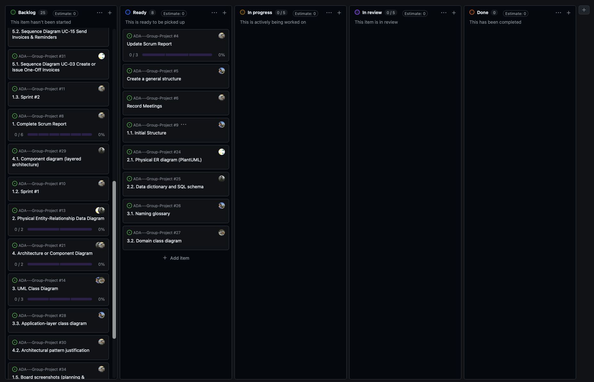
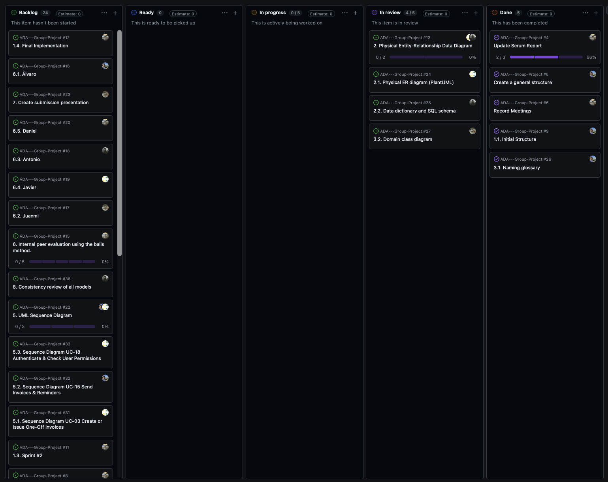
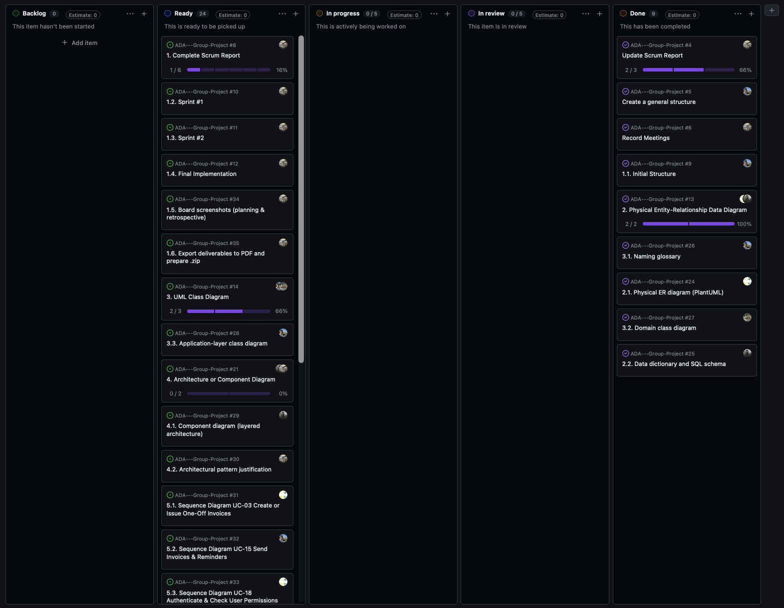
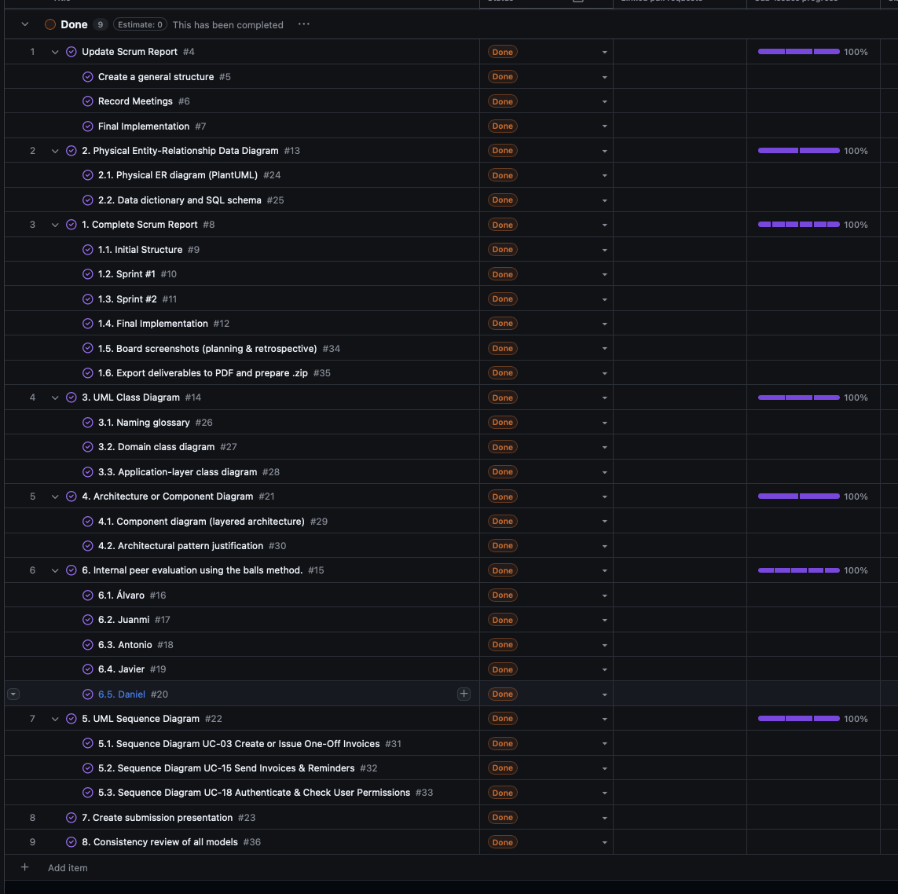

# Scrum Report: Delivery 2

## 1. Team Identification

| Full Name | Role |
| --- | --- |
| Daniel Ortega Casado | Scrum Master |
| Álvaro Navas Martínez | Member |
| Javier Pérez Rubio | Member |
| Juan Miguel Reyes Pérez | Member |
| Antonio Doblás Sánchez | Member |

**Scrum Master justification:** the team decided to rotate the Scrum Master role between submissions so that every member gains experience coordinating the project. Daniel was chosen for Submission 2 because he had already taken care of most of the GitHub configuration during the first delivery, he is comfortable with GitHub Projects (boards, iterations and issue assignment), and his availability during the weeks of this delivery was the most regular of the group, which made him the best option to follow up on the tasks and keep the board up to date. Álvaro, Scrum Master during Submission 1, supported him during the first week to ease the handover.

### Distribution of responsibilities

| Member | Main responsibilities in Submission 2 | Issues |
| --- | --- | --- |
| Daniel Ortega Casado | Scrum Master: GitHub Project board and sprint setup, meeting minutes, Scrum Report, board screenshots, PDF export and Campus Virtual delivery. Architectural pattern justification. | #4, #6, #7, #8, #10, #11, #12, #15, #20, #21, #30, #34, #35 |
| Álvaro Navas Martínez | Initial structure of the Scrum Report, naming glossary, application-layer class diagram and UC-15 sequence diagram. | #5, #9, #14, #16, #22, #26, #28, #32 |
| Javier Pérez Rubio | Physical ER diagram, UC-03 and UC-18 sequence diagrams. | #13, #19, #22, #24, #31, #33 |
| Juan Miguel Reyes Pérez | Domain class diagram and submission presentation. | #14, #17, #23, #27 |
| Antonio Doblás Sánchez | Data dictionary and SQL schema, component diagram and final consistency review of all the models. | #13, #18, #21, #25, #29, #36 |

All members took part in the review of every artifact and completed their own internal peer evaluation (balls method).

## 2. Work Organization

Work on Submission 2 started on **29/10/2026** and the delivery is due on **18/11/2026**. The period was divided into **two sprints** of roughly ten days each, managed in the GitHub Project **"Submission 2"** of the repository.

* **Product Backlog:** all the work required by the Submission 2 statement was broken down into GitHub issues, one parent issue per artifact and one sub-issue per piece of work:
  * #8 Complete Scrum Report → #9 Initial Structure, #10 Sprint #1, #11 Sprint #2, #12 Final Implementation, #34 Board screenshots, #35 Export deliverables to PDF and prepare .zip
  * #13 Physical ER Diagram → #24 Physical ER diagram (PlantUML), #25 Data dictionary and SQL schema
  * #14 UML Class Diagram → #26 Naming glossary, #27 Domain class diagram, #28 Application-layer class diagram
  * #21 Architecture / Component Diagram → #29 Component diagram, #30 Architectural pattern justification
  * #22 UML Sequence Diagram → #31 UC-03, #32 UC-15, #33 UC-18
  * #15 Internal Peer Evaluation → #16 – #20 (one per member)
  * #23 Submission presentation, #36 Consistency review of all models
  * The pending issues from the Submission 1 feedback were also kept: #4 Update Scrum Report → #5 Create a general structure, #6 Record Meetings, #7 Final Implementation.
* **Sprint Backlog:** at each Sprint Planning the issues for that sprint were moved to the corresponding iteration (Sprint 1 / Sprint 2) and each one was **assigned in GitHub to the member responsible**. Parent issues of diagrams were assigned to a pair, and each sub-issue to one person, so that every artifact had an author and a second person who knew it in depth.
* **Task status:** the board uses the columns *Todo*, *In Progress*, *In Review* and *Done*. A task was only moved to *Done* after another member (different from the author) had reviewed it.
* **Meetings:** the team held a meeting **every Sunday at 11:00**, with an average duration of **one hour**. The Sunday meeting worked as the weekly sync: progress review, problems found, board update and assignment of tasks for the following week. Sprint Planning and Sprint Review/Retrospective were held during these Sunday meetings. Daily coordination between meetings was done through the team's group chat.
* **Version control:** the work of Submission 2 was done in the `sprint2` branch. Each commit references its issue (e.g. `Closes #24`), so the board shows the commits of every task, and the branch was merged into `main` with a pull request reviewed by the team.

## 3. Meetings Held

### Meeting 1 – Sprint 1 Planning

* **Date:** Sunday 01/11/2026
* **Time:** 11:00 – 12:05 (65 min)
* **Participants:** Daniel, Álvaro, Javier, Juan Miguel, Antonio
* **Main topics:**
  * Reading and discussion of the Submission 2 statement and of the Scrum Report requirements (Operations Guide, section 4.5).
  * Review of the feedback received for Submission 1 and of the pending issues (#4 – #7).
  * Handover of the Scrum Master role from Álvaro to Daniel.
  * Definition of the two sprints and review of the Product Backlog created in the GitHub Project.
  * Identification of the main entities of the system from the requirements and use cases (clients, employees, subscriptions, invoices, payments, messages, roles, system parameters, audit log).
  * Choice of tools: PlantUML for all the diagrams (as in Submission 1) and MySQL 8 as the target database.
* **Agreements / tasks assigned for the week:**
  * **Daniel:** configure the Sprint 1 / Sprint 2 iterations, labels and columns in the board, apply the Submission 1 feedback to the Scrum Report (#4) and start the meeting log (#6).
  * **Álvaro:** create the initial structure of the new Scrum Report (#9, #5) and write the first version of the naming glossary (#26).
  * **Javier:** first version of the Physical ER Diagram (#24): tables, attributes, data types, primary and foreign keys.
  * **Antonio:** data dictionary and SQL script (#25), in parallel with Javier's diagram.
  * **Juan Miguel:** first draft of the domain class diagram (#27), focusing on Client, Subscription, Invoice, Payment and User.
  * **All:** read the use case specification again before the next meeting to check that the models cover every use case.

### Meeting 2 – Sprint 1 Review & Retrospective / Sprint 2 Planning

* **Date:** Sunday 08/11/2026
* **Time:** 11:00 – 11:55 (55 min)
* **Participants:** Daniel, Álvaro, Javier, Juan Miguel, Antonio
* **Main topics:**
  * Review of the ER diagram: discussion about the relationship between clients and employees (UC-07, assign/unassign clients) and about how to store the audit log (UC-17) so that it cannot be edited.
  * Review of the domain class diagram draft: some names and attributes did not match the ER diagram (e.g. invoice status, inbox task status).
  * Retrospective of Sprint 1: the work in pairs worked well. The main problem was that the ER and class diagrams were developed in parallel without enough communication.
  * Sprint 2 Planning: choice of the architectural pattern and selection of the use cases to be represented with sequence diagrams (UC-03, UC-15 and UC-18).
* **Agreements / tasks assigned for the week:**
  * Agreement to use the glossary (#26) as the single source of names, and to follow a **layered architecture (presentation, business logic and data access)** with an integration layer for the PDF generator, mail service, WhatsApp and payment synchronization.
  * **Javier and Antonio:** close the ER diagram and the SQL script: intermediate client–employee assignment table, append-only audit log table and cardinalities.
  * **Juan Miguel:** finish the domain class diagram with methods, multiplicities and the Invoice generalization (recurring / one-off), and start the presentation (#23).
  * **Álvaro:** application-layer class diagram (#28) and UC-15 sequence diagram (#32).
  * **Javier:** UC-03 (#31) and UC-18 (#33) sequence diagrams.
  * **Antonio:** component diagram (#29).
  * **Daniel:** architectural pattern justification (#30), move the Sprint 1 issues to *Done* / *In Review*, update the board and fill in the Sprint 1 section of the report (#10).

### Meeting 3 – Sprint 2 Follow-up

* **Date:** Sunday 15/11/2026
* **Time:** 11:00 – 12:00 (60 min)
* **Participants:** Daniel, Álvaro, Javier, Juan Miguel, Antonio
* **Main topics:**
  * Review of the component diagram and of the three sequence diagrams.
  * Consistency check between the class diagrams, the sequence diagrams (every message must be an existing method) and the component diagram. Three naming problems were found and fixed in the meeting.
  * Organization of the last days before the delivery: presentation, peer evaluation, exports to PDF and repository structure.
* **Agreements / tasks assigned until the delivery (18/11):**
  * **Álvaro and Javier:** apply the method-name fixes to the sequence diagrams.
  * **Juan Miguel:** fix the domain class diagram (new `TaskStatus` enum, `Invoice.getClient()`) and finish the presentation (#23).
  * **Antonio:** final consistency review and traceability matrix (#36).
  * **Daniel:** board screenshots (#34), Sprint 2 and final sections of the Scrum Report (#11, #12), export the deliverables to PDF and prepare the `.zip` for the Campus Virtual submission (#35).
  * **All:** complete the internal peer evaluation using the balls method (#16 – #20) before Tuesday night.

## 4. Sprints Performed

### Sprint 1

* **Start date:** 29/10/2026
* **End date:** 08/11/2026
* **Sprint Goal:** Organize the delivery and complete the data and static design of the system: Physical ER Diagram, data dictionary, glossary and domain class diagram, plus the base of the Scrum Report.
* **Planned tasks:**
  * #4 Update Scrum Report according to Submission 1 feedback, #6 Record Meetings (Daniel)
  * #5 / #9 Scrum Report – Initial Structure (Álvaro)
  * #26 Naming glossary (Álvaro)
  * #24 Physical ER diagram (Javier)
  * #25 Data dictionary and SQL schema (Antonio)
  * #27 Domain class diagram (Juan Miguel)
* **Completed tasks:** #4, #5, #6, #9 and #26 were completed. #24, #25 and #27 reached a complete first version but were moved to *In Review* and finished at the beginning of Sprint 2, after aligning the names between the ER and class diagrams.
* **Meetings held:** 2 (01/11/2026 and 08/11/2026).
* **Issues encountered:** inconsistencies between the ER diagram and the class diagram because they were developed in parallel. Doubts about how to model the client–employee assignment and the non-editable audit log.
* **Solutions applied:** the glossary became the single source of names. Intermediate assignment table in the ER diagram. Audit log modelled as an append-only table (triggers) and as an immutable class without setters.

#### Board Status at Sprint Planning

#### Board Status at Sprint Retrospective

### Sprint 2

* **Start date:** 09/11/2026
* **End date:** 18/11/2026
* **Sprint Goal:** Complete the architectural and dynamic design of the system (application class diagram, component diagram and sequence diagrams), check the consistency of all the models and prepare the delivery (Scrum Report, presentation and peer evaluation).
* **Planned tasks:**
  * #24, #25, #27 final adjustments (Javier, Antonio, Juan Miguel)
  * #28 Application-layer class diagram (Álvaro)
  * #29 Component diagram (Antonio), #30 Architectural pattern justification (Daniel)
  * #31 UC-03 and #33 UC-18 sequence diagrams (Javier), #32 UC-15 sequence diagram (Álvaro)
  * #36 Consistency review (Antonio)
  * #23 Submission presentation (Juan Miguel)
  * #15 – #20 Internal peer evaluation (everyone)
  * #7, #10, #11, #12, #34, #35 Scrum Report, screenshots and delivery (Daniel)
* **Completed tasks:** all the planned tasks.
* **Meetings held:** 1 (15/11/2026), plus the Sprint 2 planning held in the meeting of 08/11/2026.
* **Issues encountered:** messages in the sequence diagrams that did not correspond to methods of the class diagrams. Less time available because of exams of other courses in the same weeks.
* **Solutions applied:** cross review between the class diagram and sequence diagram authors, plus a final consistency review (#36). The delivery tasks (exports, presentation, `.zip`) were planned in advance in the meeting of 15/11 to avoid last-minute work.

#### Board Status at Sprint Planning

#### Board Status at Sprint Retrospective

## 5. Issues and Risks

| Problem / Risk | Sprint | Impact | Solution applied | Status |
| --- | --- | --- | --- | --- |
| ER and class diagrams developed in parallel with different names for the same concepts | 1 | Rework of both diagrams and a delay of 2–3 days in closing them | Shared naming glossary (#26) and joint review | Resolved |
| Doubts about how to model the client–employee assignment (UC-07) and the non-editable audit log (UC-17) | 1 | Slowed down the ER diagram | Discussed in the meeting of 08/11: intermediate table and append-only log table | Resolved |
| Sequence diagram messages not matching class diagram methods (`getClient()`, `receiveDeliveryStatus()`, task status) | 2 | Inconsistency between models | Cross review and consistency review (#36) | Resolved |
| FR-08 (annual review campaign) has no use case in Submission 1 | 2 | Requirement not reflected in the design | Documented as an open point in the consistency review | Pending (Submission 3) |
| Reduced availability due to exams and deliveries of other courses | 2 | Risk of not finishing on time | Tasks planned in advance and divided so that one member could cover for another | Resolved |
| Sprint 2 shorter than recommended because of the delivery date | 2 | Less margin for reviews | Delivery tasks scheduled in the meeting of 15/11 | Resolved |

## 6. Final Assessment

**What has been achieved:** the team has delivered all the artifacts required for Submission 2: Physical ER Diagram (with data dictionary and SQL script), UML Class Diagrams (domain and application layers), Architecture / Component Diagram with the rationale of the chosen patterns, UML Sequence Diagrams for UC-03, UC-15 and UC-18, Scrum Report and internal peer evaluation. All of them are consistent with the requirements and use cases defined in Submission 1, as shown in the traceability matrix of the consistency review. The work has been organized in two sprints managed in GitHub Projects, with every issue assigned to its responsible member and weekly meetings every Sunday.

**What has worked well:** the Sunday meetings gave the team a fixed rhythm and a clear moment to review progress and redistribute tasks. Splitting each artifact into sub-issues with one owner made responsibilities clear, and linking each commit to its issue made the progress visible on the board. The feedback from Submission 1 was applied from the first week.

**What should be improved:** the models that depend on each other should not be developed in complete isolation. The team should agree on the shared vocabulary before starting. Some tasks stayed in *In Progress* longer than necessary because the board was only updated on Sundays.

**Actions for the next submission:**
* Define the glossary and dependencies between artifacts during Sprint Planning.
* Update the board as soon as a task changes status, not only during the weekly meeting.
* Hold a short mid-week check-in during the last week before each delivery.
* Decide how to handle FR-08 (annual review campaign).
* Rotate the Scrum Master role again for Submission 3.
