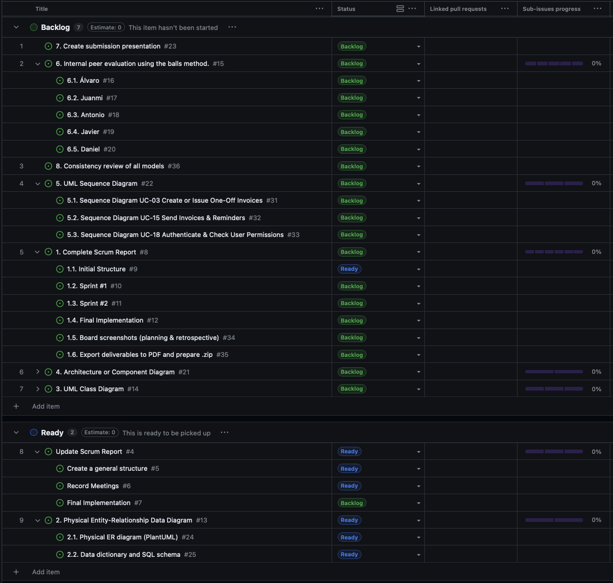
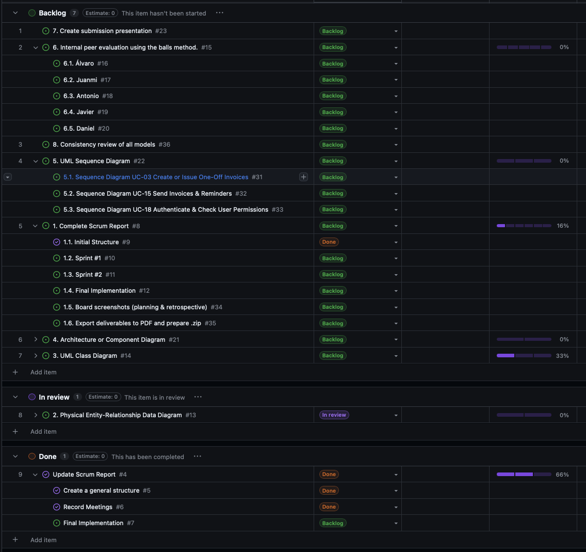
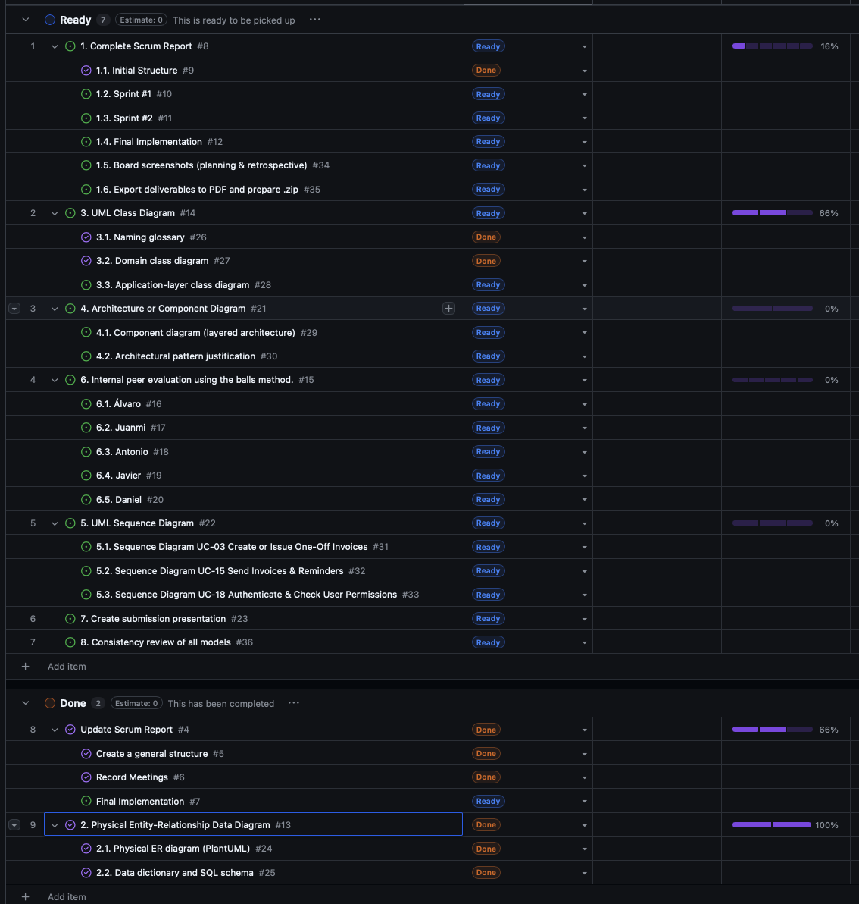
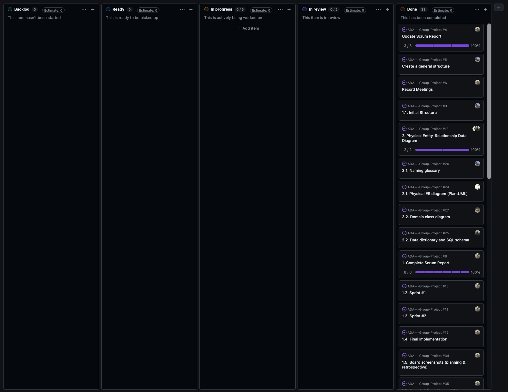

# Scrum Report: Delivery 2

## 1. Team Identification

| Full Name | Role |
| --- | --- |
| Daniel Ortega Casado | Scrum Master |
| Álvaro Navas Martínez | Member |
| Javier Pérez Rubio | Member |
| Juan Miguel Reyes Pérez | Member |
| Antonio Doblás Sánchez | Member |

**Scrum Master justification:** The team decided to rotate the Scrum Master role between submissions so that every member gains experience coordinating the project. Daniel was chosen for Submission 2 through a democratic vote after he volunteered for the role, given that Álvaro, the previous Scrum Master, could not be re-elected.

## 2. Work Organization

Work on Submission 2 started on **29/10/2026** and the delivery is due on **18/11/2026**. The period was divided into **two sprints** of roughly ten days each, managed in the GitHub Project **"Submission 2"** of the repository.

* **Product Backlog:** all the work required by the Submission 2 statement was broken down into GitHub issues. The pending issues coming from the feedback of Submission 1 were also kept in the backlog.
* **Sprint Backlog:** at each Sprint Planning the issues for that sprint were moved to *Ready*, and each one was assigned in GitHub to the member or members responsible. Diagrams were always assigned to pairs so that every artifact had an author and a second person who knew it in depth.
* **Task status:** the board uses the columns *Ready*, *In Progress*, *In Review* and *Done*. A task was only moved to *Done* after it was reviewed in a meeting.
* **Meetings:** the team held several meetings, with an average duration of one hour. The Sunday meeting worked as the weekly sync: progress review, problems found, board update and assignment of tasks for the following week. Sprint Planning and Sprint Review/Retrospective were held during these Sunday meetings. Daily coordination between meetings was done through the team's group chat.

## 3. Meetings Held

### Meeting 1 – Sprint 1 Planning

* **Date:** Sunday 01/11/2026
* **Time:** 11:10 – 12:05 (55 min)
* **Participants:** Daniel, Álvaro, Javier, Juan Miguel, Antonio
* **Main topics:**
  * Reading and discussion of the Submission 2 statement and of the Scrum Report requirements.
  * Review of the feedback received for Submission 1 and of the pending issues.
  * Handover of the Scrum Master role from Álvaro to Daniel.
  * Definition of the two sprints and review of the Product Backlog created in the GitHub Project.
  * Identification of the main entities of the system from the requirements and use cases (clients, employees, subscriptions, invoices, payments, messages, roles, system parameters, audit log).
* **Agreements / tasks assigned for the week:**
  * **Daniel:** configure the Sprint 1 / Sprint 2 iterations, labels and columns in the board; apply the Submission 1 feedback to the Scrum Report and start the meeting log.
  * **Álvaro:** create the initial structure of the new Scrum Report and start the first draft of the class diagram with Juan Miguel.
  * **Juan Miguel:** first draft of the UML Class Diagram together with Álvaro, focusing on the domain classes (Client, Subscription, Invoice, Payment, Employee).
  * **Javier and Antonio:** first version of the Physical ER Diagram: tables, attributes, data types, primary keys and foreign keys.
  * **All:** read the use case specification again before the next meeting to check that the models cover every use case.

### Meeting 2 – Sprint 1 Review & Retrospective / Sprint 2 Planning

* **Date:** Sunday 08/11/2026
* **Time:** 11:05 – 11:45 (40 min)
* **Participants:** Daniel, Álvaro, Javier, Juan Miguel, Antonio
* **Main topics:**
  * Review of the ER diagram: discussion about the relationship between clients and employees and about how to store the audit log so that it cannot be edited.
  * Review of the class diagram draft: some names and attributes did not match the ER diagram.
  * Retrospective of Sprint 1: the work in pairs worked well, the main problem was that the ER and class diagrams were developed in parallel without enough communication.
  * Sprint 2 Planning: choice of the architectural pattern and selection of the use cases to be represented with sequence diagrams.
* **Agreements / tasks assigned for the week:**
  * Agreement to follow a layered architecture with an external integration layer for the PDF generator, mail service and payment synchronization.
  * **Javier and Antonio:** close the ER diagram: add the intermediate client–employee assignment table, the audit log table and the cardinalities.
  * **Juan Miguel and Álvaro:** finish the class diagram with methods, multiplicities, associations and the Invoice generalization (subscription invoice / one-off invoice).
  * **Daniel and Antonio:** first version of the Architecture / Component Diagram, including the rationale for the chosen pattern.
  * **Javier and Álvaro:** start the UML Sequence Diagrams for UC-03 and UC-15.
  * **Daniel:** move the Sprint 1 issues to *Done* / *In Review*, update the board and fill in the Sprint 1 section of the report.

### Meeting 3 – Sprint 2 Follow-up

* **Date:** Sunday 15/11/2026
* **Time:** 11:00 – 12:00 (60 min)
* **Participants:** Daniel, Álvaro, Javier, Juan Miguel, Antonio
* **Main topics:**
  * Review of the component diagram and of the two sequence diagrams.
  * Consistency check between the class diagram, the sequence diagrams and the component diagram.
  * Organization of the last days before the delivery: presentation, peer evaluation, exports to PDF and repository structure.
* **Agreements / tasks assigned until the delivery (18/11):**
  * **Javier and Álvaro:** finish the sequence diagram for UC-18 and fix the method names detected in the consistency review.
  * **Daniel and Antonio:** final version of the component diagram and written justification of the architectural pattern.
  * **Juan Miguel:** prepare the submission presentation with the contributions of the rest of the members.
  * **Antonio:** final consistency review of all the models against the requirements and use cases of Submission 1.
  * **Daniel:** complete the Sprint 2 and final sections of the Scrum Report, export the deliverables to PDF and prepare the `.zip` for the Campus Virtual submission.
  * **All:** complete the internal peer evaluation using the balls method (#16 – #20) before Tuesday night.

## 4. Sprints Performed

### Sprint 1

* **Start date:** 29/10/2026
* **End date:** 08/11/2026
* **Sprint Goal:** Organize the delivery and complete the data and static design of the system: Physical ER Diagram and UML Class Diagram, plus the base of the Scrum Report.
* **Planned tasks:**
  * #4 Update Scrum Report according to Submission 1 feedback (Daniel)
  * #6 Record Meetings (Daniel)
  * #9 Scrum Report – Initial Structure (Álvaro)
  * #13 Physical Entity-Relationship Data Diagram (Javier, Antonio)
  * #14 UML Class Diagram (Juan Miguel, Álvaro)
* **Completed tasks:** #4, #6 and #9 were completed. #13 and #14 reached a complete first version but were moved to *In Review* and finished at the beginning of Sprint 2 after aligning names between both diagrams.
* **Meetings held:** 2 (01/11/2026 and 08/11/2026).
* **Issues encountered:** Doubts about how to model the client–employee assignment and the non-editable audit log.
* **Solutions applied:** The audit log modelled as an append-only table with no update operations in the class diagram.

#### Board Status at Sprint Planning

#### Board Status at Sprint Retrospective

### Sprint 2

* **Start date:** 09/11/2026
* **End date:** 18/11/2026
* **Sprint Goal:** Complete the architectural and dynamic design of the system (Component Diagram and Sequence Diagrams), close the pending models and prepare the delivery (Scrum Report, presentation and peer evaluation).
* **Planned tasks:**
  * #13 and #14 final adjustments (Javier, Antonio / Juan Miguel, Álvaro)
  * #21 Architecture or Component Diagram (Daniel, Antonio)
  * #22 UML Sequence Diagram (Javier, Álvaro)
  * #23 Create submission presentation (Juan Miguel)
  * #15 Internal peer evaluation – #16 Álvaro, #17 Juanmi, #18 Antonio, #19 Javier, #20 Daniel
  * #8 Complete Scrum Report – #10 Sprint #1, #11 Sprint #2, #12 Final Implementation (Daniel)
* **Completed tasks:** all the planned tasks. An extra sequence diagram (UC-18) was added during the sprint.
* **Meetings held:** 1 (15/11/2026), plus the Sprint 2 planning held in the meeting of 08/11/2026.
* **Issues encountered:** messages in the sequence diagrams that did not correspond to methods of the class diagram, and less time available because of exams of other courses in the same weeks.
* **Solutions applied:** cross review between the class diagram and sequence diagram pairs, and the delivery tasks were planned in advance in the meeting of 15/11 to avoid last-minute work.

#### Board Status at Sprint Planning

#### Board Status at Sprint Retrospective

## 5. Issues and Risks

| Problem / Risk | Sprint | Impact | Solution applied | Status |
| --- | --- | --- | --- | --- |
| Doubts about how to model the client–employee assignment (UC-07) and the non-editable audit log (UC-17) | 1 | Slowed down the ER diagram | Discussed in the meeting of 08/11: intermediate table and append-only log table | Resolved |
| Sequence diagram messages not matching class diagram methods | 2 | Inconsistency between models | Cross review between pairs and update of the class diagram | Resolved |
| Reduced availability due to exams and deliveries of other courses | 2 | Risk of not finishing on time | Tasks planned in advance and divided in pairs so that one member could cover for the other | Resolved |

## 6. Final Assessment

**What has been achieved:** We successfully delivered all the required artifacts for Submission 2. Everything aligns well with the requirements and use cases we defined in Submission 1. We managed the workload across two sprints using GitHub Projects, ensuring every issue was assigned, and kept everything on track with weekly meetings every Sunday.

**What has worked well:** Our Sunday meetings gave us a steady rhythm and a dedicated time to review progress and redistribute tasks. Working in pairs was also a huge plus, as it meant that at least two people fully understood each diagram. Additionally, we made sure to apply the feedback from Submission 1 right from the first week.

**What should be improved:** We realized that interdependent models shouldn't be developed in isolation. We need to agree on a shared vocabulary before diving in. Also, some tasks sat in In Progress way too long simply because we were only updating the GitHub board on Sundays.

**Actions for the next submission:**
* Update the board as soon as a task changes status, not only during the weekly meeting.
* Hold a short mid-week check-in during the last week before each delivery.
* Rotate the Scrum Master role again for Submission 3.
